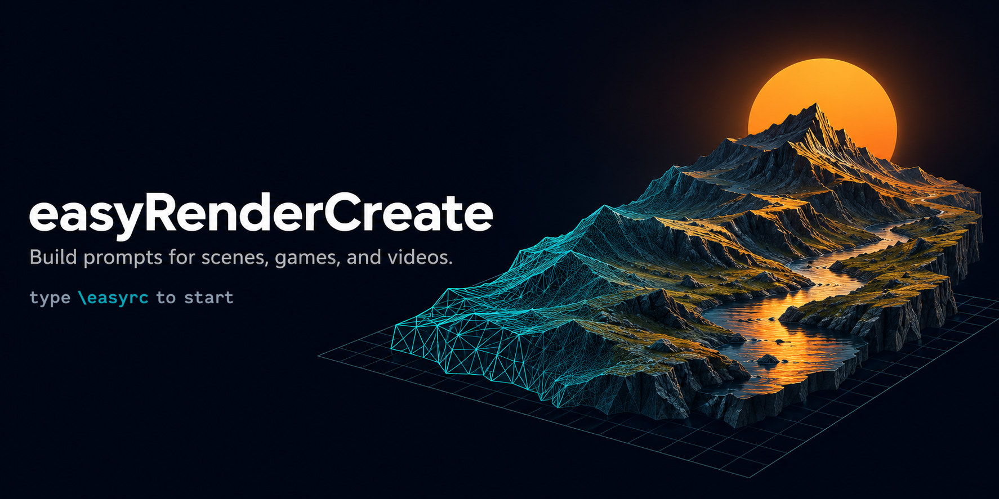

<p align="center">
  
</p>

<p align="center">
  <b>Turn an idea into a ready-to-use build prompt for a procedural 3D scene, browser game, or video.</b><br>
  An interview skill for ChatGPT, Claude and Google Antigravity.
</p>

<p align="center">
  <a href="https://github.com/Benfic4rthur/easyRenderCreate/releases/latest/download/easyrendercreate.zip"><b>Download the skill (.zip)</b></a>
  ·
  <a href="#install">Install</a>
  ·
  <a href="#quick-start">Quick start</a>
  ·
  <a href="#how-it-works">How it works</a>
</p>

---

## Quick start

After installing the skill, start a new chat and type:

```text
\easyrc em português
```

This starts the interview and delivers the final prompt in Portuguese. You can name any language, or choose them separately by asking for the interview in one language and the prompt in another. Type `\easyrc` on its own to pick a language before you start.

## What it does

**easyRenderCreate** turns a vague wish ("I want to make something beautiful with code, no idea what") into a complete, ready-to-paste prompt for a coding agent such as Claude Code, Codex, Antigravity or Cursor.

The prompt makes the agent build one of three things, entirely with code, running in the browser:

| Format | What you get |
|---|---|
| **Browser scene** | A real-time 3D world you explore or watch play automatically |
| **Game** | A small original browser game: exploration, arcade, puzzle, or racing, with controls and a goal or score suited to the idea |
| **Video** | A sequence rendered by code and exported as a video file |

No images, 3D models or sound files: every shape, texture and sound is generated by code, and the result ships as a single `index.html`.

If you are starting from scratch, the skill uses a mood and setting to pitch three concepts. If you already have an idea, include its format, setting, and mood with `\easyrc` to skip straight to shaping the world. You can also share references such as images, links, a script, or brand colors.

## How it works

Once the interview starts, you can answer in your own words or use the letters for questions with options (`1B 2A 3D`).

1. **Format and feeling.** Choose how people will experience your idea. Then pick the mood and the kind of place that pulls you in.
2. **Three concepts, if needed.** Each idea has a signature image, a palette, and a sense of movement. Pick one, mix two, or ask for more.
3. **The world.** Choose what goes in, what stays out and the hero frame.
4. **Format details.** Choose camera controls or autoplay for a scene, or set the destination, length, and storyboard for a video. For a game, define what the player does, how a run ends, and the controls and difficulty. Levels and scoring are optional.
5. **Your machine.** The device and monitor it has to look perfect on. The skill works out the resolution and performance budget for you.
6. **Ground rules.** What wins when visuals and smoothness conflict, how pure the tech should be, and which agent will run the prompt.
7. **Game details, if needed.** Confirm the threats, usable objects and story that affect play.
8. **Summary.** A short brief to approve before receiving the prompt.

Then it delivers the full prompt in one block, ready to copy.

## What the prompt looks like

Every prompt follows the same compact template, about 30 to 45 lines. Each section is there so the agent can work for hours without coming back to ask:

| Section | Why it's there |
|---|---|
| **Opening** | What it is, in two sentences, and what matters |
| **PRIORITIES** | What wins when two goals conflict |
| **CONSTRAINTS** | Technical rules and explicit exclusions from your brief |
| **TARGET** | A reference machine, a resolution and a measurable frame-time budget (for video: resolution, fps, length and render time) |
| **SCENE** | The world as concrete items, each with color, light, scale and motion |
| **CONTROLS** | Controls or automatic playback. A game adds its rules of play. An exported video uses SEQUENCE for its timed shots |
| **VERIFICATION** | A visual critic that only sees the renders, never the code, plus real measurements. Games add a playtest, videos a technical check of the file |
| **DONE WHEN** | When it's finished and what to hand over |

## Install

Download [`easyrendercreate.zip`](https://github.com/Benfic4rthur/easyRenderCreate/releases/latest/download/easyrendercreate.zip) from the latest release, or clone this repository. The skill is the `easyrendercreate` folder and follows the open [Agent Skills](https://agentskills.io/specification) format, so the same folder works everywhere.

### ChatGPT

Skills in ChatGPT are available on Business, Enterprise, Healthcare and Edu workspaces ([OpenAI help](https://help.openai.com/en/articles/20001066-skills-in-chatgpt)).

1. In the sidebar, open **Plugins** and go to the **Skills** tab.
2. Choose **Create → Upload from your computer** and upload `easyrendercreate.zip`.
3. Wait for the automatic scan to finish.
4. In any chat, type `\easyrc`, or pick the skill with `@easyrendercreate`.

**No Skills on your plan?** Create a custom GPT instead. Upload `SKILL.md` and every file in `references/` as **Knowledge**, and set the instructions to:

```text
Follow SKILL.md from the knowledge files from start to finish, and read the other files when it tells you to. Start the interview whenever the user types \easyrc.
```

### Claude (desktop app and claude.ai)

1. Open **Settings → Capabilities** and make sure code execution is on.
2. Under **Skills**, upload `easyrendercreate.zip`.
3. In a new chat, type `\easyrc`.

### Claude Code

```bash
git clone https://github.com/Benfic4rthur/easyRenderCreate.git
cp -R easyRenderCreate/easyrendercreate ~/.claude/skills/
```

Start a new session and type `\easyrc` (or `/easyrendercreate`).

### Google Antigravity

Copy the folder into your global skills directory ([Antigravity docs](https://antigravity.google/docs/skills)):

```bash
git clone https://github.com/Benfic4rthur/easyRenderCreate.git
mkdir -p ~/.gemini/config/skills
cp -R easyRenderCreate/easyrendercreate ~/.gemini/config/skills/
```

For a single project, use `<your-project>/.agents/skills/easyrendercreate/` instead. Then type `\easyrc` (or `/easyrendercreate`).

Menu names can change between app versions.

## Using the prompt

1. Open an empty folder in your coding agent.
2. If the skill listed reference images, put them in a `references/` folder there.
3. Paste the prompt and let it run. Expect a long session: the agent keeps iterating with the visual critic until nothing serious is left.

## Repository layout

```
easyrendercreate/
├── SKILL.md                    interview flow and delivery rules
└── references/
    ├── prompt-template.md      the prompt template and a filled-in example
    ├── scene.md                browser scene: interactive or automatic playback
    ├── game.md                 game: questions and template details
    ├── video.md                video: questions and template details
    ├── budgets.md              resolution and performance budgets, critic setup per agent
    └── user-references.md      how your images, texts and brand info are used
```

## Customizing

- Questions and options live in `SKILL.md` and in the format files.
- Performance numbers live in `references/budgets.md`.
- The prompt template lives in `references/prompt-template.md`.
