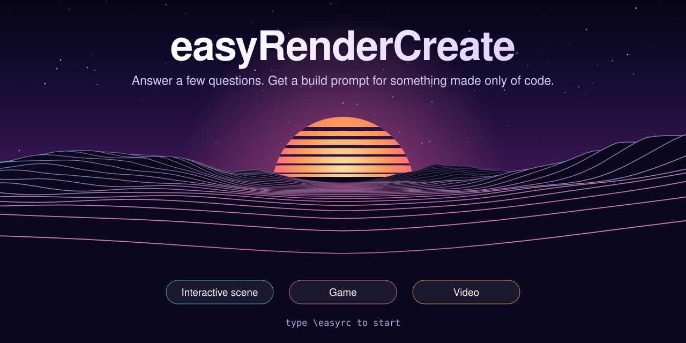

<p align="center">
  
</p>

<p align="center">
  <b>Answer a few questions. Get a build prompt for something made only of code.</b><br>
  An interview skill for ChatGPT, Claude and Google Antigravity.
</p>

<p align="center">
  <a href="https://github.com/Benfic4rthur/easyRenderCreate/releases/latest/download/easyrendercreate.zip"><b>Download the skill (.zip)</b></a>
  ·
  <a href="#install">Install</a>
  ·
  <a href="#how-it-works">How it works</a>
</p>

---

## What it does

**easyRenderCreate** turns a vague wish ("I want to make something beautiful with code, no idea what") into a complete, ready-to-paste prompt for a coding agent such as Claude Code, Codex, Antigravity or Cursor.

The prompt makes the agent build one of three things, entirely with code, running in the browser:

| Format | What you get |
|---|---|
| **Interactive scene** | A 3D world you explore with a free camera |
| **Game** | A small original game with a goal, controls and a score |
| **Video** | A sequence rendered by code and exported as a video file |

No images, 3D models or sound files: every shape, texture and sound is generated by code, and the result ships as a single `index.html`.

You don't need to know what you want to make. The skill starts from a feeling and a place, pitches three concepts and builds the rest with you. If you do have references (images, links, texts, a script, brand colors), send them along and the skill folds them into the prompt.

## How it works

Type `\easyrc` and answer seven or eight short rounds. Letters are enough (`1B 2A 3D`).

1. **Format and feeling.** Scene, game or video, or "not sure yet". Then the mood and the kind of place that pulls you in.
2. **Three concepts.** Three clearly different ideas, each with a signature image, a palette and what moves. Pick one, mix two or ask for more.
3. **The world.** A concrete list of what's in it: atmosphere, light, terrain, materials, life, landmarks. You choose the hero frame.
4. **Format details.** Movement and extras for a scene, the core loop and game feel for a game, destination, length and storyboard for a video.
5. **Your machine.** The device and monitor it has to look perfect on. The skill works out the resolution and performance budget for you.
6. **Ground rules.** What wins when visuals and smoothness conflict, how pure the tech should be, and which agent will run the prompt.
7. **Summary.** A short brief to approve, plus the language of the prompt.

Then it delivers the full prompt in one block, ready to copy.

## What the prompt looks like

Every prompt follows the same compact template, about 30 to 45 lines. Each section is there so the agent can work for hours without coming back to ask:

| Section | Why it's there |
|---|---|
| **Opening** | What it is, in two sentences, and what matters |
| **PRIORITIES** | What wins when two goals conflict |
| **CONSTRAINTS** | Rules that force craft: fully procedural, no engine, a single HTML file, no per-frame allocations |
| **TARGET** | A reference machine, a resolution and a measurable frame-time budget (for video: resolution, fps, length and render time) |
| **SCENE** | The world as concrete items, each with color, light, scale and motion |
| **CONTROLS** | How it's experienced. A game adds its rules of play; a video uses a SEQUENCE of timed shots instead |
| **VERIFICATION** | A visual critic that only sees the renders, never the code, plus real measurements. Games add a playtest, videos a technical check of the file |
| **DONE WHEN** | When it's finished and what to hand over |

## Install

Download [`easyrendercreate.zip`](https://github.com/Benfic4rthur/easyRenderCreate/releases/latest/download/easyrendercreate.zip) from the latest release, or clone this repository. The skill is the `easyrendercreate` folder and follows the open [Agent Skills](https://agentskills.io/specification) format, so the same folder works everywhere.

### ChatGPT

Skills in ChatGPT are available on Business, Enterprise, Healthcare and Edu workspaces ([OpenAI help](https://help.openai.com/en/articles/20001066-skills-in-chatgpt)).

1. In the sidebar, open **Plugins** and go to the **Skills** tab.
2. Choose **Create → Upload from your computer** and upload `easyrendercreate.zip`.
3. Wait for the automatic scan to finish.
4. In any chat, type `\easyrc`, or pick the skill with `@easyrendercreate`.

**No Skills on your plan?** Create a custom GPT instead. Upload `SKILL.md` and every file in `references/` as **Knowledge**, and set the instructions to:

```text
Follow SKILL.md from the knowledge files from start to finish, and read the other files when it tells you to. Start the interview whenever the user types \easyrc.
```

### Claude (desktop app and claude.ai)

1. Open **Settings → Capabilities** and make sure code execution is on.
2. Under **Skills**, upload `easyrendercreate.zip`.
3. In a new chat, type `\easyrc`.

### Claude Code

```bash
git clone https://github.com/Benfic4rthur/easyRenderCreate.git
cp -R easyRenderCreate/easyrendercreate ~/.claude/skills/
```

Start a new session and type `\easyrc` (or `/easyrendercreate`).

### Google Antigravity

Copy the folder into your global skills directory ([Antigravity docs](https://antigravity.google/docs/skills)):

```bash
git clone https://github.com/Benfic4rthur/easyRenderCreate.git
mkdir -p ~/.gemini/config/skills
cp -R easyRenderCreate/easyrendercreate ~/.gemini/config/skills/
```

For a single project, use `<your-project>/.agents/skills/easyrendercreate/` instead. Then type `\easyrc` (or `/easyrendercreate`).

Menu names can change between app versions.

## Using the prompt

1. Open an empty folder in your coding agent.
2. If the skill listed reference images, put them in a `references/` folder there.
3. Paste the prompt and let it run. Expect a long session: the agent keeps iterating with the visual critic until nothing serious is left.

## Repository layout

```
easyrendercreate/
├── SKILL.md                    interview flow and delivery rules
└── references/
    ├── prompt-template.md      the prompt template and a filled-in example
    ├── scene.md                interactive scene: questions and template details
    ├── game.md                 game: questions and template details
    ├── video.md                video: questions and template details
    ├── budgets.md              resolution and performance budgets, critic setup per agent
    └── user-references.md      how your images, texts and brand info are used
```

## Customizing

- Questions and options live in `SKILL.md` and in the format files.
- Performance numbers live in `references/budgets.md`.
- The prompt template lives in `references/prompt-template.md`.
